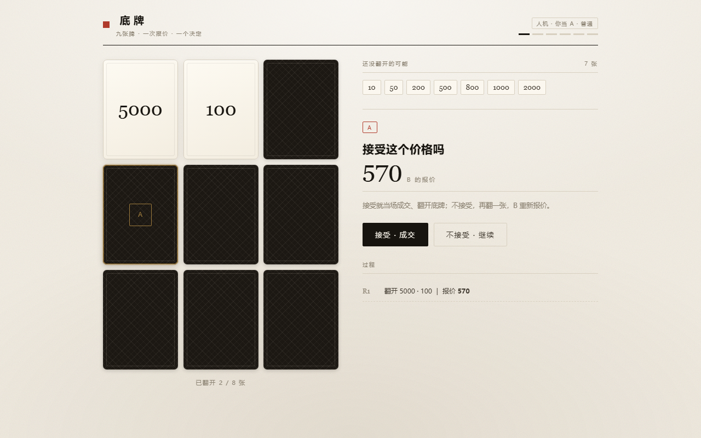
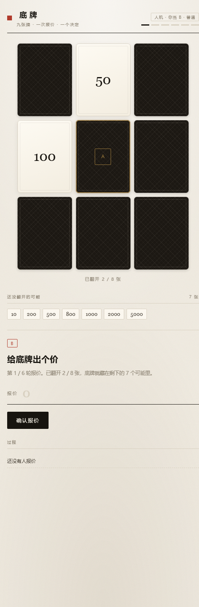

# 底牌 · 翻牌议价

**中文** | [English](#english)

## 项目简介

九张按价格从低到高写好的牌。A 扣一张底牌，然后自己挑牌翻开；B 全程只报价；A 决定「成交」还是「继续」，一路不成交就摊牌比大小。

单文件网页（`index.html`），原生 HTML / CSS / JS，无依赖、无后端，双击即玩。

当前版本：**v1.1**

## 预览





## 玩法

1. **写牌**：9 个牌位逐张填写，按价格从低到高——越便宜的越靠上，第 9 张最贵。数字当价格，文字当物品（如「手机」）；牌的大小就按这个顺序比。
2. **A 选底牌**：A 点任意一张扣下来（金框 A 印），全程不见光。
3. **翻牌 + 报价**：A 自己挑 2 张翻开 → B 报价 → A 接受或拒绝。拒绝后每轮 A 再挑 1 张，共 6 轮报价。
4. **终局**：最后一次报价仍不接受，A 翻开最后一张——这张就是 B 的底牌，随即摊牌。
5. **摊牌**：按写牌顺序比大小。A 的更贵＝A 是赌王；B 的更贵＝B 赢；两张内容一样＝流局。
6. **成交结算**：九张全是数字时，会算「成交价 − 底牌价值」的差额；有文字牌则只展示成交结果。

## 对局模式

| 模式 | 你玩 | 电脑玩 |
| --- | --- | --- |
| 本地双人 | A 和 B | — |
| 人机 · 我当 A | 选底牌 / 翻牌 / 决定 | B（报价） |
| 人机 · 我当 B | 报价 | A（选底牌 / 翻牌 / 决定） |
| 教学模式 | A | B（简单），顶部 6 步讲解随对局推进 |

- 难度三档：简单 / 普通 / 困难。简单时电脑容易出高价、也容易接受低价；困难时它压价更狠，只在自己觉得划算时才成交。
- 电脑看不到你的底牌，和你一样只能按「还没翻开的可能」估算。
- 人机与教学模式需要九张牌都是数字（电脑要按价格算）；本地双人支持文字牌。
- 第一次玩建议点设置页的「教学模式」，跟着走一遍就知道每一步在博弈什么。

## 功能

- 3×3 牌面式设置页：逐张编辑，Enter 跳下一张，多行文本粘贴自动分发
- 两种对局：本地双人 hot-seat、人机对战（自选当 A 或 B，三档难度）
- 教学模式：6 步讲解跟着对局走，随时可「退出教学 · 回首页」
- 洗牌动画：切牌 → 交错 → 收拢 → 逐张落入棋盘
- 3D 翻牌、金框 / 青框标记 A、B 的底牌
- 候选价值池实时更新，B 报价时能看到还剩哪些可能
- 每轮报价与决定记入「过程」列表
- 响应式：手机单列（棋盘 → 价值池 → 操作区），≥760px 左右分栏
- 「再来一局」重新洗牌，「换一组牌」回到设置页

## 快速开始

直接双击 `index.html` 即可运行；也可以起一个本地静态服务：

```bash
python -m http.server 8000
```

然后打开 <http://localhost:8000>。

## 目录结构

```
d:\Project\DZDY\
├─ index.html                 # 游戏本体（结构、样式、逻辑全部内联）
├─ docs/screenshots/          # README 截图
└─ .trae/                     # 设计与过程记录：需求 / 方案 / 进展
```

## License

MIT

---

<a id="english"></a>

# Bottom Card · Flip & Bargain

## Overview

Nine cards, written from cheapest to most expensive. Player A hides one card as the bottom card and flips the rest; player B only makes price offers. A accepts (deal) or refuses (keep flipping). If A refuses every offer, both bottom cards are revealed and compared.

Single-file web page (`index.html`) in plain HTML / CSS / JS — no dependencies, no backend, double-click to play.

Version: **v1.1**

## Preview


## How to play

1. **Write the cards**: fill 9 slots in ascending price order — cheapest on top, the 9th is the most expensive. Numbers count as prices, text counts as items (e.g. "phone"). This order is also the value order used to compare cards.
2. **A picks a bottom card**: click any card to hide it (gold "A" seal); it stays face down.
3. **Flip and bid**: A picks 2 cards to reveal → B names a price → A accepts or refuses. After each refusal A reveals 1 more card, for 6 rounds of bidding.
4. **Endgame**: if A refuses the last offer, A reveals the final card — that card becomes B's bottom card — and the showdown starts.
5. **Showdown**: cards are compared by the written order. A's card is more valuable → A is the winner; B's card is more valuable → B wins; identical contents → draw.
6. **Deal settlement**: when all nine cards are numeric, the page shows the gap between the offered price and the hidden card's value; with text cards only the deal itself is shown.

## Game modes

| Mode | You | Computer |
| --- | --- | --- |
| Local 2P | both A and B | — |
| vs AI · you are A | pick, flip, decide | B (bids) |
| vs AI · you are B | bid | A (picks, flips, decides) |
| Tutorial | A | B (easy) with a 6-step guide |

- Three difficulty levels. On easy the AI overbids and accepts low offers; on hard it squeezes the price and only deals when it clearly profits.
- The AI never peeks at the bottom card — it estimates from the cards still face down, exactly like you.
- AI and tutorial modes require nine numeric cards; local 2P still supports text cards.

## Features

- 3×3 card-style setup: edit slot by slot, Enter moves to the next one, pasting multiple lines fills them in order
- Two ways to play: local hot-seat, or vs AI (choose A or B, three difficulty levels)
- Tutorial mode: a 6-step guide that follows the hand
- Shuffle animation: cut → interleave → gather → deal into the board
- 3D card flip, gold / indigo seals for A's and B's bottom cards
- Live candidate pool so B can see which values are still possible
- Every offer and decision is listed in the process log
- Responsive: single column on phones (board → pool → actions), two columns from 760px
- "Play again" reshuffles the same cards; "Change cards" returns to the setup page

## Quick start

Open `index.html` directly, or serve the folder locally:

```bash
python -m http.server 8000
```

Then open <http://localhost:8000>.

## Project structure

```
d:\Project\DZDY\
├─ index.html                 # the whole game (markup, styles, logic inlined)
├─ docs/screenshots/          # README screenshots
└─ .trae/                     # design notes: requirements / plan / progress
```

## License

MIT
